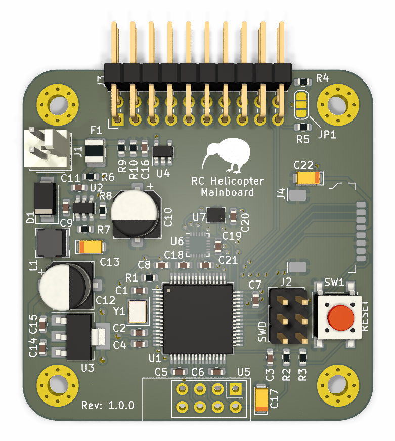
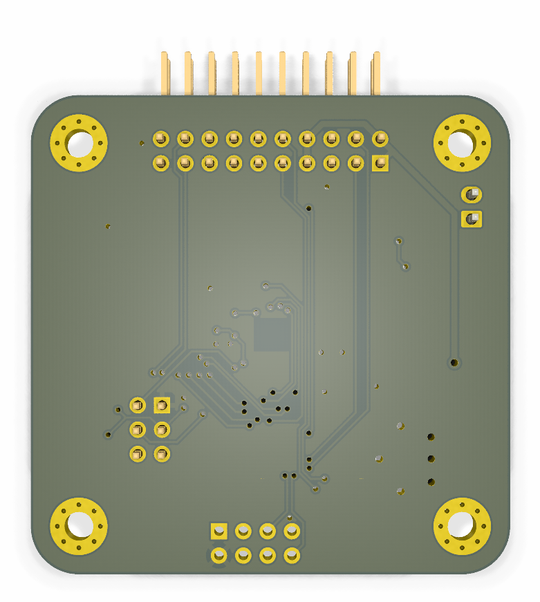

# RC Helicopter Mainboard

## Overview

This project is a custom PCB control system for an RC helicopter, centered around the STM32L452RET6 microcontroller. It manages key functions including motor control (main, tail, and servos), sensor interfacing (MPU, BMP), wireless communication (NRF module), and data logging (SD card).

It consists of two main components: the [Mainboard](https://github.com/ikajdan/rc_helicopter_mainboard) for onboard control and the [Remote](https://github.com/ikajdan/rc_helicopter_remote) for ground-based operation.

## Features

The board features an STM32L452RET6 microcontroller powered from a LiPo battery via a regulated 3.3 V supply for the MCU and peripherals. It uses a 16 MHz crystal oscillator for precise clocking. Communication is handled through an NRF24L01 wireless module. Sensor integration includes the MPU9250 for motion sensing and the BMP280 for pressure measurement. Data logging is supported via an SD card interface.

## PCB Design

The PCB stackup consists of two layers. The board is compact and integrates all necessary components for the helicopter's control system.

| Front View                            | Back View                           |
|---------------------------------------|-------------------------------------|
|  |  |

## Power Supply

The power system consists of a buck converter based on the ADP2302, stepping down the LiPo battery voltage (+BATT) to a regulated +5V output using a 2.2 µH inductor, dual 10 µF output capacitors, and a SK36A Schottky diode. The output voltage is set via a resistor divider (R7 = 39 kΩ, R8 = 7.5 kΩ), yielding approximately 4.96 V. This +5V rail feeds an LM1117-3.3 linear regulator to provide a stable +3.3V supply, with 100 nF capacitors on both input and output.

For battery voltage monitoring, an LM321 op-amp buffers a voltage divider (R9 = 100 kΩ, R10 = 33 kΩ) filtered by a 10 nF capacitor, forming a low-pass filter with ~641 Hz cutoff. The output (DV_BATT) gives a scaled voltage suitable for ADC input, with a maximum of ~3.126 V corresponding to a fully charged 3S battery.

## License

This project is licensed under the [CERN Open Hardware Licence Version 2 - Permissive (CERN-OHL-P)](https://ohwr.org/cern_ohl_p_v2.txt).
You are free to use, modify, and distribute this design, provided you retain notices and disclaimers as specified in the license terms. See the [LICENSE](LICENSE.md) file for full details.
